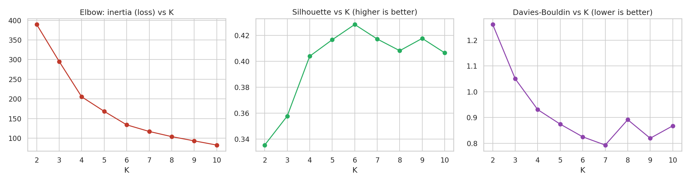
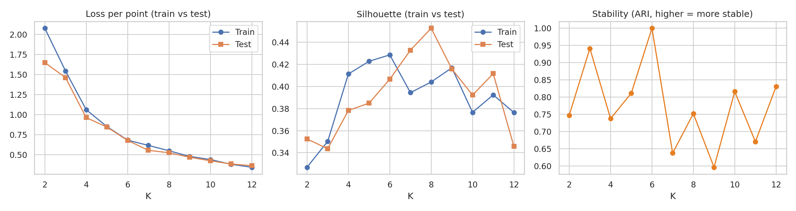
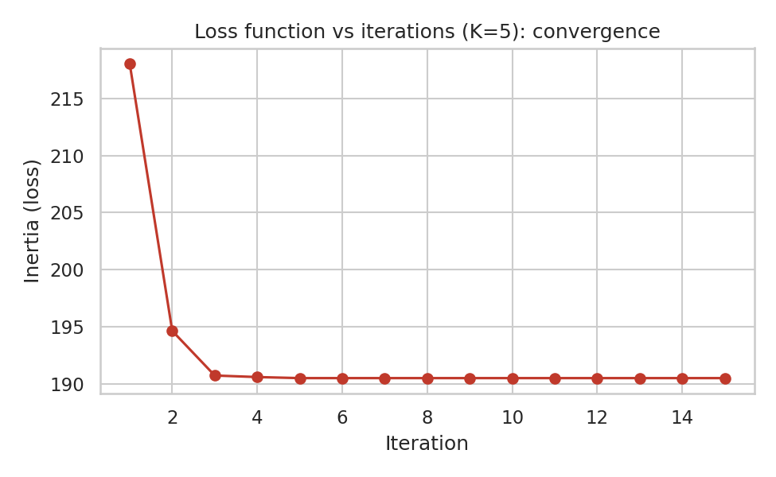
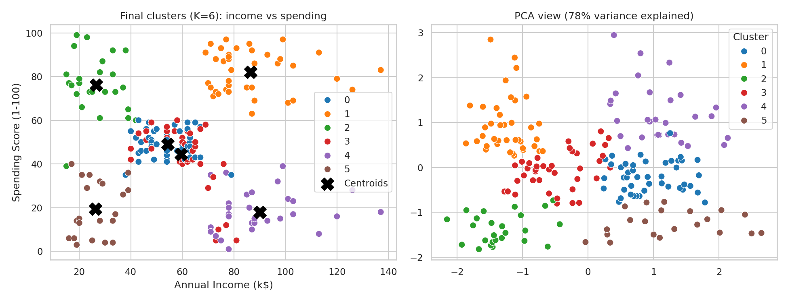

# K-Means Clustering: Customer Segmentation

Implementation and optimization of the **K-means clustering algorithm** using Python and Scikit-learn on a real-world customer segmentation problem (Mall Customers).

> ML Theory Assignment: implement K-means on a real-life example, document it, optimize it, and check for overfitting / underfitting.

## Purpose

A shopping mall wants to understand its customers. K-means groups customers into segments based on **Age, Annual Income and Spending Score**, so each group can get targeted offers (e.g. loyalty programs for high spenders, discounts for price-sensitive shoppers).

## Dataset

- **Mall Customers** (200 rows): `CustomerID, Gender, Age, Annual Income (k$), Spending Score (1-100)`
- Source: public customer-segmentation dataset (also on Kaggle). Place `Mall_Customers.csv` next to the notebook to use your own copy. If it cannot be loaded, the notebook falls back to a generated dataset with the same columns.
- Features used: Age, Annual Income, Spending Score.

## Steps

| # | Step | Purpose |
|---|------|---------|
| 1 | Load data and EDA | Check shape, missing values, duplicates, distributions |
| 2 | Scale features (`StandardScaler`) | K-means uses distance, so features must be on the same scale |
| 3 | Baseline model (K=3, random init, 1 run) | Reference point before optimization |
| 4 | Loss and accuracy graphs | Loss = inertia (WCSS); accuracy-like score = silhouette |
| 5 | Elbow + silhouette + Davies-Bouldin for K=2..10 | Choose the number of clusters |
| 6 | Optimization (grid search) | Tune K, initialization, `n_init`, solver; compare before vs after |
| 7 | Overfitting / underfitting check | 70/30 split: train vs test loss and silhouette, plus stability |
| 8 | Final model + segment interpretation | Cluster centroids, PCA plot, business meaning |

## How the code is optimized

K-means has no activation functions, optimizers or data augmentation like a neural network, so the equivalent levers are:

- **Optimizer:** initialization (`random` vs `k-means++`) and solver (`lloyd` vs `elkan`)
- **Fine-tuning:** grid search over K, `n_init`, solver using the silhouette score
- **Data preparation (augmentation equivalent):** scaling and feature selection
- **Overfitting / underfitting:** compare train vs held-out test loss and silhouette across K

## Results

Run on the Mall Customers data (200 customers, features: Age, Annual Income, Spending Score, all scaled).

| Metric | Baseline (K=3) | Optimized (K=6) |
|---|---|---|
| Inertia (loss, lower is better) | 297.00 | 134.35 |
| Silhouette (higher is better) | 0.350 | 0.431 |
| Davies-Bouldin (lower is better) | 1.042 | 0.835 |
| Calinski-Harabasz (higher is better) | 100.49 | 134.48 |

Best configuration: `K=6, init=k-means++, n_init=1, algorithm=elkan`.

**What the tuning showed:** the number of clusters (K) mattered most. All top grid-search configurations scored within about 0.004 silhouette of each other, so initialization, restarts and solver had only a small effect on this small dataset.

**Overfitting / underfitting (70/30 train/test split):**
- Train and test loss fall together and stay close, so there is no large train/test gap.
- K=2-3 underfits: high loss and low silhouette.
- Train silhouette is highest at K=6; the test silhouette is noisy because the test set has only 60 points, and it falls for large K (about K≥9), meaning extra clusters only split real groups.
- K=6 gave identical clusters on two different resamples (Adjusted Rand Index = 1.0), so the clustering is stable.

### Graphs (in `results/`)

| | |
|---|---|
|  |  |
|  |  |

## Customer segments

K-means found 6 customer groups. Averages come from the final model (Section 8 of the notebook):

| Cluster | Avg age | Avg income (k$) | Avg spending score | Customers | Segment | Suggested action |
|---|---|---|---|---|---|---|
| 0 | 56 | 54 | 49 | 45 | Older, average income, average spending | Steady engagement, loyalty rewards |
| 1 | 33 | 87 | 82 | 39 | High income, high spending (premium) | VIP and loyalty offers |
| 2 | 26 | 27 | 76 | 25 | Young, low income, high spending | Deals and discounts |
| 3 | 26 | 59 | 44 | 40 | Young, average income, average spending | Engagement and promotions |
| 4 | 44 | 90 | 18 | 30 | High income, low spending | Personalized promotions to raise spending |
| 5 | 46 | 26 | 19 | 21 | Low income, low spending | Low priority, price-based offers |

## How to run

**Google Colab:** upload `kmeans_customer_segmentation.ipynb` → Runtime → Run all.

**Locally:**
```bash
pip install -r requirements.txt
jupyter notebook kmeans_customer_segmentation.ipynb
```

## Project structure

```
├── kmeans_customer_segmentation.ipynb   # full implementation
├── requirements.txt
├── README.md
└── results/                             # graphs and CSV outputs (created when the notebook runs)
```

## Limitations and next steps

- K-means assumes round, similar-sized clusters and is sensitive to outliers.
- Try DBSCAN or Gaussian Mixture Models, and add more features such as purchase history.
